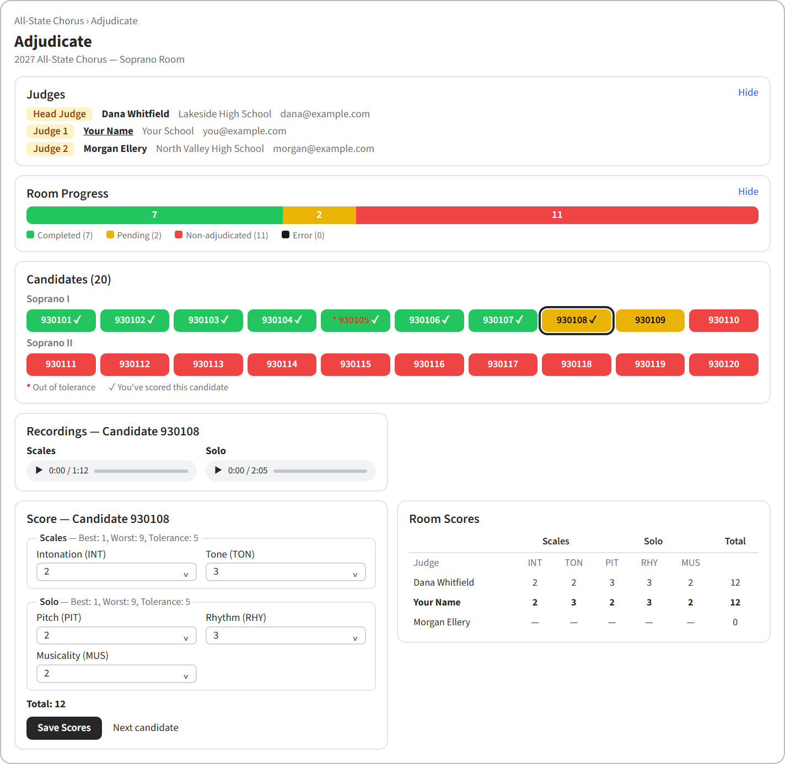

# Adjudicator Guide

*A guide to using TheDirectorsRoom.com as an audition judge.*

## 1. Welcome

Thank you for judging. TheDirectorsRoom.com is where you hear your assigned candidates, enter your scores, and compare them with the other judges in your room. Nearly everything you need is on one page, called **Adjudicate**.

A few terms are used precisely throughout the site and this guide, so it's worth knowing them up front:

- **Event** — the audition program itself, such as an All-State Chorus.
- **Version** — one specific year's run of an Event. You're assigned to judge in a particular Version.
- **Room** — the group of judges, voice parts, and score categories you're assigned to. A remote audition has Rooms too; they just aren't physical places.
- **Candidate** — one student's audition in this Version. You'll see only a candidate number, never a name or school.
- **Rubric** — everything your Room scores. It's made up of categories (Scales or Solo, for example), and each category contains factors.
- **Factor** — one individual score within a category. You choose a score for every factor.
- **Tolerance** — how far apart the judges' score totals may be for one candidate before that candidate is flagged.
- **Event Manager** — the person who runs the Version. This is who to contact if something isn't right.

Judging comes down to one loop: open a candidate, listen, score every factor, save, and move on to the next.

## 2. Before you begin

You need a TheDirectorsRoom.com account, and you must be assigned to a Room. The site doesn't email you when you're assigned; your Event Manager will tell you, along with the dates you can judge.

1. Log in at **thedirectorsroom.com** with your usual email address and password. If you're a teacher logging in for the first time, finish the setup wizard first (see the Teacher Guide).
2. Select **Events** in the sidebar. It appears once you've been assigned to a Room.
3. Find your Event in the list and select the teal **Adjudicate** button.

The Adjudicate button appears only when all of these are true:

- You're assigned as a judge in one of this Version's Rooms.
- The Version is Active.
- The adjudication window is open. Your Event Manager sets its start and end dates.
- Your account doesn't belong to a currently enrolled student.

For a remote audition, use headphones or good speakers, and check your sound before you enter any scores.

## 3. The Adjudicate page at a glance

**Page: Adjudicate** (select the Adjudicate button on the Events page)

The Version and your Room's name are at the top. Below them, in order:

- **Judges** — everyone assigned to your Room, with role, school, email address, and cell phone when on file. Your own name is underlined.
- **Room Progress** — a colored bar showing how far your whole Room has come, not just you.
- **Candidates** — every candidate in your Room, as a colored button for each number. This is how you move around.
- **Recordings** — remote auditions only; appears once you select a candidate.
- **Score** — your scoring form; appears once you select a candidate.
- **Room Scores** — every judge's scores for the selected candidate; appears once you've saved your own.

Use **Hide** and **Show** on the Judges and Room Progress cards to make more space for scoring.

*A mock-up of the Adjudicate page for a remote audition. Names, numbers, and scores are made up, and your Event's rubric will differ.*

## 4. Reading the candidate list

Candidates are grouped by voice part and listed in number order. Every judge in your Room sees the same list in the same order. Each button's color shows where the **whole Room** stands with that candidate:

- **Red** — Non-adjudicated. No judge has saved scores yet.
- **Yellow** — Pending. Some scores are in, but not from every judge.
- **Green** — Completed. Every judge in the Room has scored this candidate.
- **Black** — Error. More scores are on file than the rubric calls for. Contact your Event Manager.

Two marks can also appear on a button:

- **Check mark** — **you** have finished scoring this candidate. This is the one to watch to track your own progress.
- **Red asterisk** — the Room's scores for this candidate are out of tolerance (see §7).

A yellow button with a check mark is normal: your scores are in, and another judge's aren't yet. Everyone on the Judges card counts toward Completed.

The colors don't update by themselves while you sit on the page. They catch up whenever you select a candidate or save, or when you refresh your browser.

## 5. Listening to recordings

This section applies to remote auditions. For an in-person audition, no Recordings card appears: select the number of the candidate in front of you and go straight to the scoring form.

When you select a candidate, the Recordings card shows an audio player for each recording your Room scores, in the same order as your rubric. Play, pause, and replay as often as you need.

- You'll see only recordings that have been approved. If none have, the card reads **"No approved recordings yet."**
- You'll see only the recordings that match your Room's categories. A Room that scores only Solo won't see Scales.
- If a recording stops or won't play after the page has been open for an hour or more, refresh your browser. Save your scores first, because a refresh clears anything unsaved.

## 6. Scoring a candidate

1. Select a candidate number. The selected button gets a ring around it, and the number appears in the Score heading. **Check that it matches** the candidate you're hearing.
2. Read the line at the top of each category. It shows the **Best** and **Worst** scores. In some Events the best score is the lowest number, so check before you start.
3. Choose a score from the dropdown for **every** factor. Nothing is filled in for you.
4. Check the **Total** at the bottom. It updates as you choose, and it includes any extra weight your Event gives a factor.
5. Select **Save Scores**. Your check mark appears on the candidate's button.
6. Select **Next candidate** to go to the next one in the list that you haven't finished.

A few things to know:

- **Next candidate doesn't save.** Neither does selecting another number. Save first, or your unsaved choices are lost.
- **You can't save a partial score sheet.** If any factor is blank, you'll be asked to select a score for every factor.
- **Next candidate only moves forward.** If you skipped someone earlier, select their number in the list.
- **You can stop and come back.** Saved scores stay saved. Log in again any time while the adjudication window is open and look for buttons without a check mark.

## 7. Room Scores and tolerance

After you save your own scores for a candidate, a **Room Scores** table appears with each judge's scores and total. Your row is in bold, and a dash means that judge hasn't scored that factor yet. The table stays hidden until your scores are saved, so your first scores are always your own.

If your Room has a tolerance, the system compares the judges' score totals for each candidate. When the highest and lowest totals are farther apart than the tolerance allows, the candidate is out of tolerance:

- A red asterisk appears on the candidate's button.
- The Room Scores table turns red, with a message naming the tolerance.

Tolerance is shown beside each category, but it applies to each judge's total across the whole rubric. It uses the scores as entered, before any extra weight, so it may not match the difference between the totals in the table. A tolerance of 0 means the totals must match exactly. A dash means your Room has no tolerance.

**Being out of tolerance never blocks you from saving.** It's a prompt to compare notes. Use the contact information on the Judges card and follow your Event's own rules about whether and how judges should adjust. Because scores arrive at different times, a candidate who was in tolerance when you saved may be flagged later. Look over the list for asterisks before you consider yourself finished.

## 8. Changing a score

Select the candidate's number. Your saved scores fill in the form; change what you need and select **Save Scores** again. The new scores replace the old ones.

You can do this as often as you like while the adjudication window is open. Once it closes, contact your Event Manager about any change. The people running the Tab Room can also enter or correct scores for you, for example from a paper score sheet.

## 9. Judge check-ins

If your Event Manager has turned them on, a short check-in appears after a save when you're about one-third done, about two-thirds done, and one candidate from the end. Small Rooms may see fewer. Each one thanks you, offers a tip, and asks a couple of quick questions about your focus, your setup, or the process.

- **They're optional.** Select **No thanks** or close the window to skip one. Each is shown only once.
- **They're anonymous.** Your Event Manager sees the answers only combined with other judges', never with your name.
- **They come after your scores are saved,** so they never put your work at risk.

When you score your last candidate, you'll see a thank-you message for completing your Room.

## 10. Before you finish

1. Check that every candidate in your list has a **check mark**.
2. Look for **red asterisks** and settle them according to your Event's rules.
3. Look for **black** buttons and report any to your Event Manager.
4. Tell your Event Manager you're done, if they've asked you to. There's no final Submit button; your scores count as soon as they're saved.

Results are decided and released later by the people running the Event. You won't see them on the Adjudicate page.

## 11. Common questions

**I don't see an Adjudicate button — why?** Most likely the adjudication window hasn't opened yet or has closed. If the dates are right, ask your Event Manager to confirm that you're assigned to a Room and that the Version is Active. If you don't see Events in the sidebar at all, you may not have been assigned yet, or you may be logged in to a different account.

**It says "This room has no scoring rubric" — what do I do?** No score categories have been assigned to your Room, so there's nothing to score and no recordings to show. Contact your Event Manager.

**A candidate has no recordings, or I can't hear one clearly. Should I score it anyway?** Don't guess. Contact your Event Manager with the candidate number and follow their instructions. In the meantime, go on to the next candidate.

**I recognize a student's voice — what should I do?** Follow your Event's conflict-of-interest rules, and contact your Event Manager if you're unsure. The page shows only candidate numbers, so it can't warn you about a conflict.

**I scored the wrong candidate — can I fix it?** You can open that candidate and save the correct scores over the wrong ones, but you can't clear a score sheet back to blank. If you don't have correct scores for that candidate yet, contact your Event Manager.

**I've checked off every candidate, but Room Progress isn't all green — why?** Room Progress covers all the judges in your Room. Yellow means someone else still has scores to enter.

**My candidate list changed. Is that a mistake?** Probably not. The list always reflects the current candidates in your Room's voice parts, so it changes if a candidate is added, withdrawn, or moved to another voice part. If the Tab Room moves a candidate to another voice part, that candidate's earlier scores are removed, so you may need to score them again.

**I'm judging in two Rooms, but I only see one — why?** The Adjudicate page opens one Room per judge for each Version. Contact your Event Manager right away so they can plan around it.

**I can't finish judging. What happens to my scores?** Tell your Event Manager as soon as you can. Ask them to add your replacement as a new judge and to decide what to do with your scores before removing you. Your scores stay under your name and can't be passed to someone else, so your replacement starts with a blank score sheet for every candidate. If you're removed from the Room, the scores you've saved are permanently deleted. Your Event Manager sees a warning before that happens.

**A candidate who was green is yellow again — why?** Most likely a judge was added to your Room and hasn't scored that candidate yet. If your own check mark is still there, your scores are safe.

**Can I judge on a tablet or phone?** Yes, the page adjusts to your screen. A wide screen, such as a computer's, shows your scoring form and Room Scores side by side.

**What if I lose my internet connection?** Anything you've already saved is safe; anything you haven't may be lost. If you can't get back online, write your scores on paper and contact your Event Manager. The Tab Room can enter them for you.

**Does the system record how I work?** Yes. Along with your saved scores, it records when you open a candidate and when you play, pause, or finish a recording.
